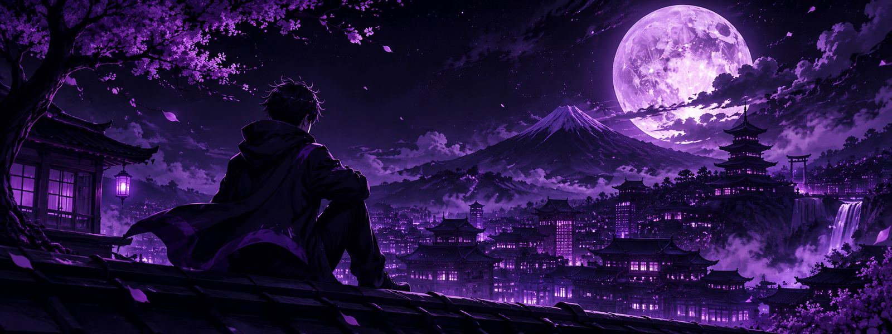
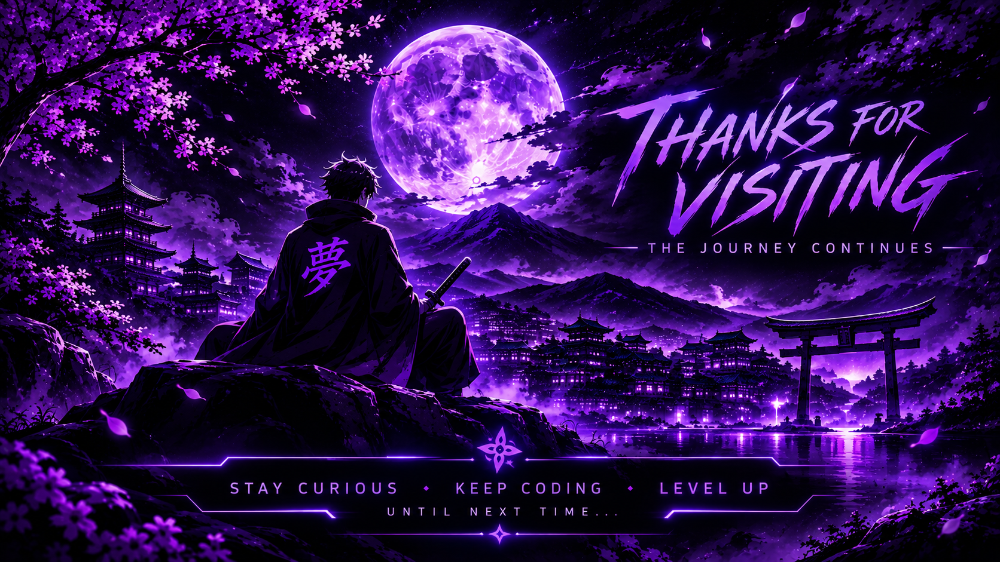

 

  

### 💻 Final-Year Bachelor of Computing Student

*Aspiring Software Developer | Tech Enthusiast | Lifelong Learner*

📍 South Africa

---

## 🧑‍💻 PLAYER PROFILE

I'm Nickyle Kannemeyer, a final-year Bachelor of Computing student at **Belgium Campus ITversity**, passionate about software development, programming and technology.

I enjoy tackling challenges, solving problems and turning ideas into practical solutions through code.

I'm a fast learner who is always looking to expand my knowledge, explore new technologies and improve my development skills.

Outside of programming, I'm interested in rugby, fitness and technology.

---

## ⚔️ CURRENT QUESTS

> *Every developer has a next level to reach.*

- 🎓 Complete my Bachelor of Computing degree.
- 💻 Improve my software development and programming skills.
- 🧠 Strengthen my problem-solving and analytical abilities.
- 🌱 Explore new technologies and development practices.
- 🔨 Gain practical experience through software development.

---

## 🛠️ SKILL TREE

### ⚡ Programming Languages

### 🔮 Frameworks & Libraries

### 🎮 Tools & Platforms

## 📫 How to Reach Me

- 📧 **Email:** [kannemeyernickyle@gmail.com](mailto:kannemeyernickyle@gmail.com)
- 📍 **Location:** Mossel Bay, South Africa

---

  

